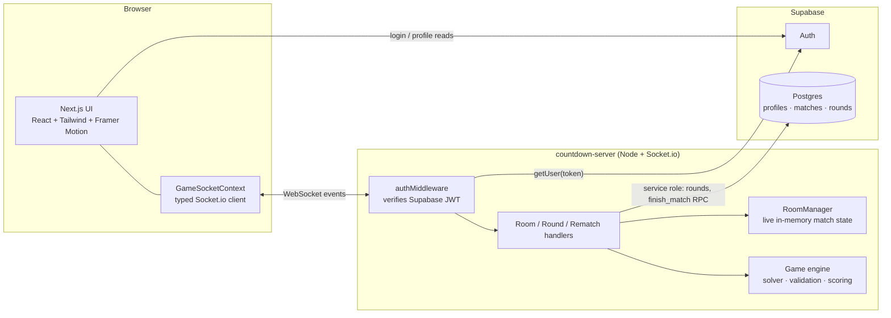

# Countdown Math Arena

**A real-time, ranked 1v1 arithmetic duel.** Two players get the same six number tiles and a three-digit target. Whoever gets closest, fastest, takes the round. First to 5 points wins the match.

Built with a Next.js frontend, a standalone server-authoritative Socket.io game server, and Supabase for auth and persistence.


---

## Table of Contents

- [Overview](#overview)
- [Features](#features)
- [How a Match Works](#how-a-match-works)
- [Architecture](#architecture)
- [Engineering Highlights](#engineering-highlights)
- [Tech Stack](#tech-stack)
- [Project Structure](#project-structure)
- [Getting Started](#getting-started)
- [Testing](#testing)
- [Data Model](#data-model)
- [Deployment](#deployment)
- [Roadmap](#roadmap)

---

## Overview

Countdown Math Arena takes the classic *Countdown* numbers round and turns it into a competitive online game. Players combine six tiles using `+`, `−`, `×` and `÷` to reach a target between 100 and 999 within 30 seconds, head to head against a live opponent.

The project is split into two deployable services:

| Service | Role |
| --- | --- |
| **Web app** (`/`) | Next.js App Router UI: auth, lobby, solo practice, live match screen. |
| **Game server** (`/countdown-server`) | Node + Socket.io. Owns all match state, timers, validation and scoring. Writes results to Supabase with a service-role client. |

## Features

### Multiplayer
- **Challenge links.** Create a match from the lobby and share a `/match/<id>` link. Your opponent joins with one click.
- **Synchronized rounds.** The server broadcasts a start timestamp, so both players' clocks agree despite network latency.
- **Live opponent status.** See when your opponent is thinking or has submitted, without revealing their answer.
- **Reconnect grace period.** A dropped player has 15 seconds to return and resume the round in progress before forfeiting.
- **Rematches.** Offer, accept or decline a rematch from the post-game modal. Accepting creates a fresh match for both players.
- **Ranked.** Win and loss records and an MMR rating are updated after every completed match.

### Solo
- **Practice board** (`/game`): the same 30-second format, offline from the opponent, with a solvability reveal.
- **Training mode** (`/training`): choose your timer (30s, 60s, stopwatch or untimed), pick how many large numbers to include, use undo, and get hints.

### Accounts and Security
- Email sign-up and login via Supabase Auth, with protected routes enforced in Next.js middleware.
- Socket connections are authenticated with the player's Supabase access token. Identity is never taken from client payloads.

## How a Match Works

1. **Setup.** Six tiles are drawn from four large numbers (`25, 50, 75, 100`) and a small pool (two copies of `1–10`). A target between 100 and 999 is generated.
2. **Solvability check.** The server runs a recursive solver once per round to find out whether the exact target is reachable and what the best approximation is.
3. **Prep and play.** A 5-second reveal, then 30 seconds to build a solution step by step.
4. **Validation.** Each submission is replayed on the server against the original tiles. Subtraction must stay positive and division must be exact. Invalid solutions score as a miss.
5. **Scoring.** Closest to the target wins; ties go to the faster player.
6. **Victory.** First player to **5.00 points** takes the match.

### Round Scoring

| Situation | Winner | Runner-up |
| --- | --- | --- |
| Winner hits the target exactly | 1.00 | 0.35 if within 3, otherwise 0 |
| Target was solvable, winner is closest but not exact | 0.70 | 0.35 if within 3, otherwise 0 |
| Target was unsolvable, winner within 3 | 1.00 | 0.40 if within 3, otherwise 0 |
| Target was unsolvable, winner within 7 | 0.80 | 0.40 if within 3, otherwise 0 |
| Target was unsolvable, winner further away | 0.50 | 0.40 if within 3, otherwise 0 |
| Equal distance and equal time | 0.35 each (solvable) / 0.50 each (unsolvable) | |
| One player times out | 1.00 | 0 |
| Both players time out | 0 each | |

Scores are stored internally as integers (`points × 100`) to avoid floating-point comparison bugs.

## Architecture



**Design principle:** the database stores durable facts (who played, what each round scored, the final result). The game server holds fast-changing live state (tiles, timers, submissions) in memory and only writes to Postgres at meaningful checkpoints: after each round and at match end.

## Engineering Highlights

- **Server-authoritative gameplay.** Clients never report a result. They submit the *steps* they took, and the server re-validates every step against the original tiles before scoring.
- **Fully typed socket contract.** `events.ts` defines `ClientToServerEvents`, `ServerToClientEvents` and `SocketData`, and these are passed to Socket.io's generics. Every `emit` and `on` call is checked at compile time.
- **Recursive backtracking solver.** Exhaustively searches tile combinations and operator orderings, with early exit on an exact hit, and reports the closest reachable value and expression.
- **Race-safe match completion.** The room is claimed and removed from memory *before* any awaited database call, so a concurrent disconnect can't trigger a second, contradictory forfeit.
- **Atomic, idempotent persistence.** Match completion goes through a `finish_match` Postgres function that updates the match row and both players' stats in one transaction and is safe to call twice.
- **Defense in depth on cheating.** The database test suite checks that a normal signed-in player cannot call `finish_match` directly or smuggle winner and score columns into an `UPDATE`.
- **Resilient reconnects.** Per-slot disconnect timers, a typed reconnect banner on the client, and state resync (`opponent_joined` + the in-progress `round_start`) on return.
- **Design system.** A custom dark "Countdown Kinetic" theme from Google Stitch, expressed as Tailwind design tokens, with glass-card surfaces and pill-shaped operator controls.

## Tech Stack

**Frontend:** Next.js 14 (App Router), React 18, TypeScript, Tailwind CSS, Framer Motion, Lucide icons, `socket.io-client`, `@supabase/ssr`

**Game server:** Node.js, Express, Socket.io 4, TypeScript, `@supabase/supabase-js` (service role), `tsx`

**Data and auth:** Supabase (Auth + PostgreSQL with Row Level Security)

**Testing:** Vitest (integration and database tiers)

## Project Structure

```
.
├── app/
│   ├── page.tsx                # Landing page
│   ├── login/ · register/      # Supabase Auth screens
│   ├── lobby/                  # Profile stats, challenge-link creation
│   ├── game/                   # Solo practice board
│   ├── training/               # Solo training (timer modes, hints, undo)
│   └── match/[matchId]/        # Live multiplayer match screen
├── components/                 # Navbar, RoundResultModal, GameOverModal,
│                               # RematchModal, ReconnectBanner, WaitingLobby, ...
├── context/
│   └── GameSocketContext.tsx   # Owns the typed Socket.io connection + reconnect state
├── middleware.ts               # Auth guard for protected routes
│
├── countdown-server/
│   ├── src/
│   │   ├── index.ts            # Express + Socket.io bootstrap, /health endpoint
│   │   ├── game/gameEngine.ts  # Tiles, target, solver, validation, scoring
│   │   ├── rooms/RoomManager.ts# In-memory match state and timers
│   │   ├── socket/
│   │   │   ├── authMiddleware.ts
│   │   │   └── handlers/       # roomHandlers · roundHandlers · rematchHandlers
│   │   ├── supabase/adminClient.ts
│   │   └── types/events.ts     # Socket event contract
│   └── test/
│       ├── integration/        # Real sockets, mocked Supabase
│       └── db/                 # Real local Supabase: RLS, grants, finish_match
│
└── agent/                      # Development directives used while building with AI assistance
```

## Getting Started

### Prerequisites

- Node.js 18+
- A [Supabase](https://supabase.com) project (or the Supabase CLI for a local stack)

### 1. Clone and install

```bash
git clone <your-repo-url>
cd <your-repo>

npm install                       # frontend
cd countdown-server && npm install && cd ..
```

### 2. Configure environment variables

**Frontend**: create `.env.local` in the project root:

```env
NEXT_PUBLIC_SUPABASE_URL="https://<your-project>.supabase.co"
NEXT_PUBLIC_SUPABASE_ANON_KEY="<your-anon-key>"
NEXT_PUBLIC_SOCKET_URL="http://localhost:4000"
```

**Game server**: copy `countdown-server/.env.example` to `countdown-server/.env`:

```env
PORT=4000
SUPABASE_URL="https://<your-project>.supabase.co"
SUPABASE_SERVICE_ROLE_KEY="<your-service-role-key>"
ALLOWED_ORIGIN=http://localhost:3000
```

> **Security:** the service-role key bypasses Row Level Security. It must only ever live in the game server's environment, never in a `NEXT_PUBLIC_` variable and never in version control.

### 3. Run it

In two terminals:

```bash
# Terminal 1: game server (http://localhost:4000)
cd countdown-server
npm run dev

# Terminal 2: web app (http://localhost:3000)
npm run dev
```

Check the server is up with `GET http://localhost:4000/health`, which returns `{ "status": "ok" }`.

To try multiplayer locally, register two accounts (use a second browser profile or a private window), create a challenge from the lobby, and open the link as the second player.

## Testing

```bash
# From countdown-server/
npm test                # fast suite: integration tests with real sockets + mocked Supabase

# From the repo root
npm run test:integration
npm run test:db         # requires a running local Supabase
```

| Tier | What it covers |
| --- | --- |
| **Integration** | Two real socket clients joining a room and receiving identical tiles and target; scoring and persistence of a submitted round; a full match to 5 points calling `finish_match` with the right winner; mid-match disconnect forfeits; both players disconnecting without a double `finish_match`. |
| **Database** | `finish_match` updates the match and both players' stats atomically; is idempotent; rejects non-participant ids; cannot be called by a normal player; column-level grants block smuggling winner or score values into an `UPDATE`. |

The database tier is excluded from the default run because it needs a local Supabase instance.

## Data Model

The game server reads and writes the following in Supabase:

| Table / function | Purpose |
| --- | --- |
| `profiles` | `id`, `email`, `wins`, `losses`, `mmr` (new players start at 1000). |
| `matches` | `id`, `player1_id`, `player2_id`, `status`. The durable record of a match. |
| `rounds` | One row per round: target, tiles, solvable flag, each player's result, time and points, and outcomes. |
| `finish_match(...)` | `SECURITY DEFINER`, idempotent RPC that completes a match and updates both players' stats atomically. |

**Ranking:** after each match the winner gains 25 MMR and the loser loses 15 (floored at 0). A forfeit by disconnect counts as a win for the remaining player.

## Deployment

The two services deploy independently:

- **Frontend:** [Vercel](https://vercel.com). Set the three `NEXT_PUBLIC_*` variables.
- **Game server:** any host that supports long-lived WebSocket connections (Render, Railway, Fly.io). Build with `npm run build`, start with `npm start`, and set `ALLOWED_ORIGIN` to your deployed frontend origin so CORS only admits your app.
- **Health checks:** point your host at `/health`.

> Persistent WebSockets can't run inside Next.js API routes or serverless functions, which is why the game server is a separate service.

## Roadmap

Deliberately left out of the MVP:

- In-game chat
- Spectator mode
- Tournaments and 4-player free-for-all
- Cosmetic avatars and sound packs
- Configurable large-number count for multiplayer matches (currently random each round)
- Proper Elo-style rating that accounts for opponent strength (currently a fixed +25 / −15 MMR)
